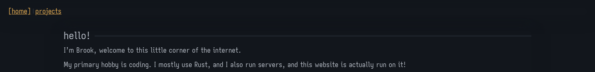
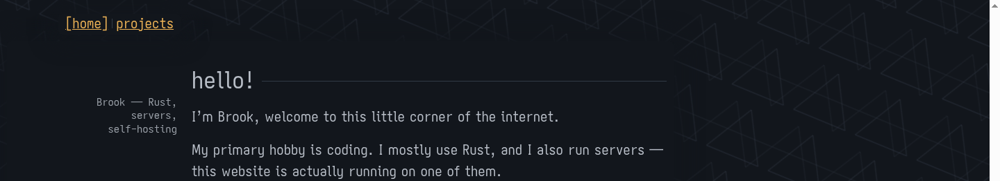
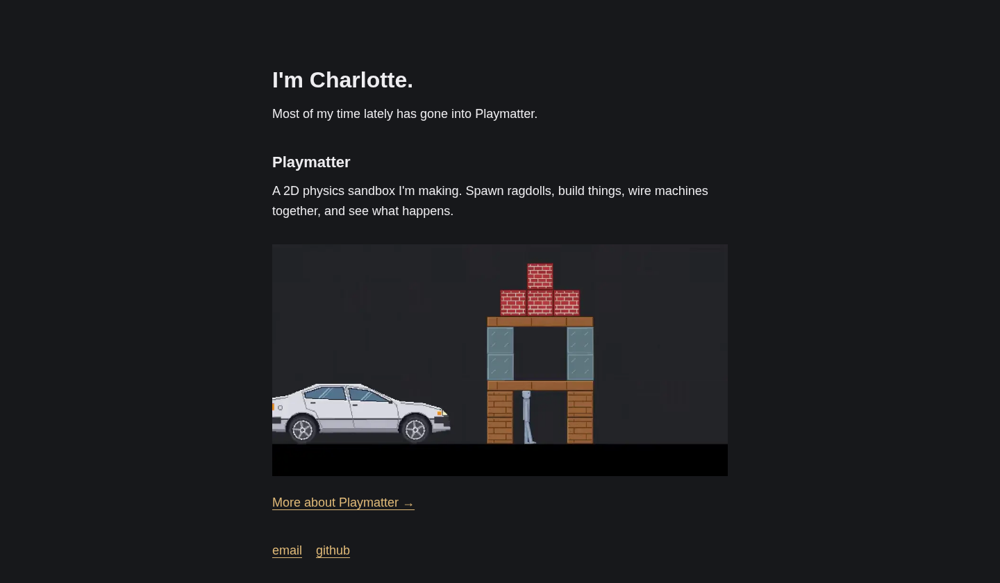
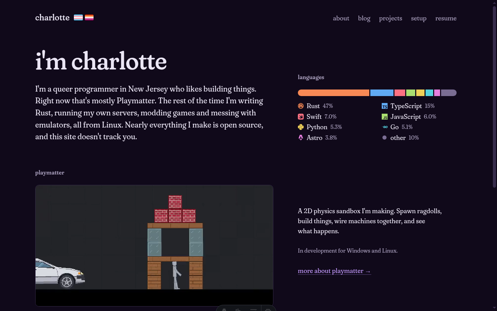

This site has been five different sites. The first one wasn't even mine.

## 1. A fork (March 2026)

It looked good, and it was simple. That's why I forked it. I did the entire fork sitting in Christopher Park, the little park across from the Stonewall Inn in New York.

The original was [darkuss](https://darkuss.twoexem.com)'s homepage, which they started in February 2025. It was built with [zs](https://git.mills.io/prologic/zs), a tiny static site generator where the components are shell scripts. It had a blog, a webring, a row of 88x31 buttons for friends, and triangles drifting in the background.

My first commit, on March 8, was called "Sitewide refactor for my website". It deleted 462 lines and added 29. The blog went, the webring went, the buttons went. What was left said "hello! I'm Brook, welcome to this little corner of the internet" and listed four projects. The footer said "website forked from darkuss", and it stayed there for the next two versions.

## 2. Zola (April 2026)

zs hadn't been updated in a long time. On April 26 I committed "ai refactor because zs is old and not updated", which moved everything to [Zola](https://www.getzola.org). The README I wrote that day:

> why tf did i not write a readme?? anyway this is my website forked from darkuss
>
> Yes i used ai to refactor the website from that old ass zs framework

The AI did everything. It did fine, because the site looked the same afterwards.

In June I committed "Update website to be even cooler :P". It added two projects. It also added 1,454 lines by accident, because I committed a folder of old build output, including eight font files of about 1.4 MB each. The site was shipping 11 MB of fonts to show four paragraphs.

## 3. Astro and Bun (August 2026)

Zola was awkward to install the same way on every machine, and the repo had drifted. On August 20 I moved to Astro and Bun and redid the layout, keeping the dark palette, the triangles, the rainbow corner and the bracketed nav.

In this version:

- The fonts went from 11 MB to 600 KB, by keeping only the characters a site in English needs.
- The text stopped running 2,000 pixels wide on a big monitor.
- The projects list grew to fifteen, with a license and a language beside each.
- It deployed to Cloudflare Pages. Before that it ran on my own server.

## 4. One page (October 2026)

I got bored of the site being like that and wanted something stupidly simple. On October 14 I deleted almost all of it. Projects, blog, credits, the triangles, the fonts: 1,566 lines out, 279 in. What was left was one page that said "I'm Charlotte", a paragraph about Playmatter, one screenshot, and two links.

It was also the first version to say Charlotte. The ones before said Brook.

## 5. Today (November 2026)

This morning I opened that one page and wrote:

> this site is mine. it is incredibly boring and doesnt look good. any ideas to liven it up, make it more unique, not become generic AI slop.

About twelve hours of constant work later, it is this. I started a new repository for it, so none of the old history came along.

All of today's site was written by [Claude Fable 5.2](https://www.anthropic.com/claude-fable-and-mythos-5-2).

What's in it now:

- **A typeface of my own.** Headings and text are set in [Torrens Serif](/projects/torrens-serif/), my cut of Fraunces with its softness all the way up and a straightened J, j and f.
- **Pages that open.** A post or a project slides in as a panel, and the site moves aside to a strip you click to go back.
- **A physics engine.** The block demo in posts runs on Mote, about 3,000 lines of my own TypeScript with no dependencies.
- **A timeline you step through**, on the [about page](/about/).
- **An editor.** `bun run edit` opens the site in a browser editor with the real page beside it, and can publish.
- **A resume that prints itself.** The PDF is made from the page every time the site is built.
- **80 KB of fonts on a page.** Down from 11 MB.

I say so, the same way my READMEs do. I decided what it should be and said no a lot. The first thing it showed me got "just out of the gate this looks horrible".

It looks so good, and it's animated well.

If you build something this way: use agents responsibly, avoid making AI slop (here's [a list of what it looks like](https://impeccable.style/slop/)), and make a lot of the decisions yourself.

## What stayed

The dark background. darkuss's first line and mine both called the site a "little corner of the internet".
